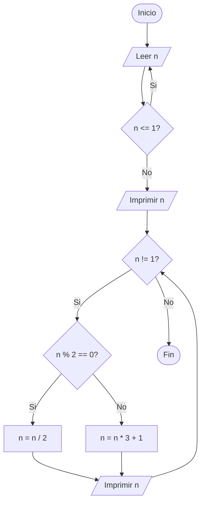

# Ejercicio 45 - Diagrama de flujo (Conjetura de Ullman)

Digitado un entero n > 1, imprimir la serie: si n es par se divide entre 2,
si es impar se multiplica por 3 y se le suma 1, hasta llegar a 1.

Ejemplo con 26: `26 13 40 20 10 5 16 8 4 2 1`

